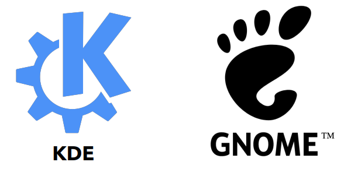
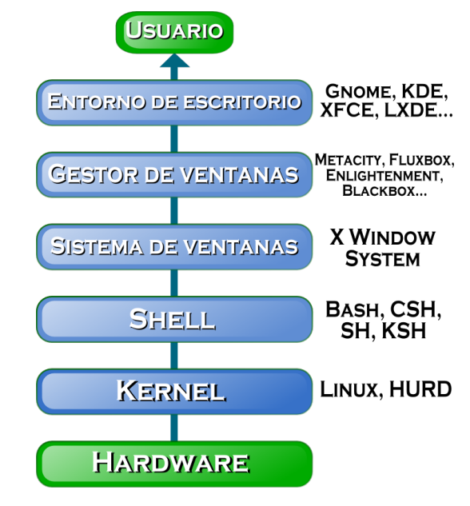

# Tema 1: La comunidad Linux y una carrera en el codigo abierto:

## La evolucion de Linux

En 1994 Linus Torvalds lanza el núcleo de un sistema operativo muy similar a UNIX (creado para grandes computadoras) pero compatible con PC. En 1992 adopta la Licencia Pública General (GPL), permitiendo el uso, modificación, redistribución y copia. Se empieza a crear una gran comunidad. Uniendo Linux (el núcleo o kernel), con otros programas libres que siguen la filosofía GNU, aparecen sistemas operativos completos:

- **1993**: Slackware y Debian
- **1994**: Red Hat
- **2002**: Arch
- **2004**: Ubuntu

## Que es una distribucion?

Una **distribución** es un sistema operativo con kernel de Linux y una selección de aplicaciones creada y mantenidas por una empresa o comunidad de usuarios.

**Hay dos grandes familias:** 

- **Derivadas de Debian**:
    - Gestionan el software con ficheros .deb y comandos dpkg, apt,... 
    - Ubuntu, Kali, Mint, MX Linx, etc

- **Derivadas de Red Hat**:
    - Gestionan el software con ficheros .rpm y comandos rpm, yum, dnf,... 
    - Fedora, CentOS, Scientific Linux, etc.

## Distribuciones mas importantes:

- **Debian GNU/Linux**: Fue lanzada por Ian Murdock. Es muy estable y utilizada en servidores. Por defecto no proporciona ningún software propietario. 
- **Ubuntu**: Creada por Mark Shuttleworth y su empresa Canonical. Su objetivo es conquistar el escritorio del usuario, pero también hay versión server. Suele lazar versiones nuevas cada seis meses y con un soporte a largo plazo (LTS) cada 2 años.
- **Red Hat**: Desarrollada y mantenida por la empresa con su mismo nombre (comprada por IBM en 2019). Ofrece soporte y licencias de pago. En 2003 pasó a llamarse Red Hat Enterprise Linux (RHEL).
- **Suse**: Distribución alemana derivada de Slackware. Conocida por su herramienta de configuración YaST. Su versión comercial es SUSE Linux Enterprise Server mientras que la gratuita es openSuse

## Linux en sistemas enbebidos y cloud
Gracias a la gran versatilidad y a su permisiva licencia, el kernel de Linux es usado en una gran cantidad de dispositivos. Adaptando el software que trabaja sobre este kernel se pueden conseguir sistemas embebidos que tienen como misión hacer funcionar hardware específico: móviles, relojes, coches, etc.

Un buen ejemplo es **Android** que desarrolla Google y que podemos encontrar el cientos de miles de dispositivos diversos.

Otro ejemplo es Raspbian, una modificación de Debian, para funcionar en el mini ordenador Raspberry Pi. Con un mínimo coste (unos 50$) se puede usar como servidor básico, centralita de telefonía IP, control para domótica y robótica, centro multimedia, etc. 

Otra área donde Linux es muy utilizado es en el **cloud computing**. Todos los proveedores (Amazon AWS, Google Cloud, Microsoft Azure,..) ofrecen distribuciones Linux que se pueden utilizar a la carta.
La mejora del hardware permite que los sistemas se puedan virtualizar y consumir sólo los recursos que se necesitan en cada momento. Unido a tecnologías modernas como los **contenedores**, las posibilidades de gestionar la funcionalidad de un sistema basado en Linux son enormes.

## Instalacion de software. Los paquetes

**Introducción**

El software en Linux se distribuye principalmente de dos formas:
- **Mediante código fuente**
    - Ventajas: se puede compilar optimizando el rendimiento para un sistema concreto. Se puede modificar y personalizar
    -  Inconvenientes: necesita los programas necesarios para interpretar el código y las librerías requeridas. Instalación más lenta y complicada 
- **Archivos instalables llamados "paquetes"**
    - Ventajas: más fácil de instalar y administrar
    - Inconvenientes: un mismo programa necesita distintos paquetes según su plataforma (x86, x64, arm, mips,....). Hay varios tipos de paquetería incompatibles entre sí.

Para facilitar su utilización, existen unos servidores públicos en internet que disponen de todos los paquetes de una distribución. Se llaman repositorios.

- **Paquetes .deb** 
    - Se usan en Debian y sus derivadas 
    - Administran los paquetes con el comando **dpkg** 
    - Utilizan los repositorios con apt (o apt-get, apt-cache...)
- **Paquetes .rpm**
    - Se usan en Red Hat y sus derivadas
    - Administran los paquetes con el comando **rpm**
    - Utilizan los repositorios con yum (dnf o zypper)

## Gestion de software utilizando paquetes y sus repositorios

<table>
  <thead>
    <tr>
      <th>Acciones</th>
      <th>.DEB</th>
      <th>.RPM</th>
    </tr>
  </thead>
  <tbody>
    <tr>
      <td>Actualizar la lista de paquetes disponibles</td>
      <td><code>apt update</code></td>
      <td>No es necesario</td>
    </tr>
    <tr>
      <td>Buscar un paquete</td>
      <td><code>apt search paquete</code></td>
      <td><code>yum search paquete</code></td>
    </tr>
    <tr>
      <td>Instalar</td>
      <td><code>apt install paquete</code></td>
      <td><code>yum install paquete</code></td>
    </tr>
    <tr>
      <td>Borrar</td>
      <td><code>apt remove paquete</code></td>
      <td><code>yum remove paquete</code></td>
    </tr>
  </tbody>
</table>

## Principales aplicaciones de ofimaticas

OpenOffice.org era la suite que más famosa, pero cuando Oracle compró la compañía que la mantenía Libreoffice (un folk) tomó su relevo. Ambas están compuestas por:

- **Writer:** procesador de texto
- **Calc:** hoja de cálculo
- **Impress:** creación de prentaciones
- **Draw:** dedicado el dibujo vectorial
- **Math:** editor de fórmula matemáticas
- **Base:** para bases de datos

## Aplicaciones multimedia 

Hay distribuciones como **Ubuntu Studio** que están dedicadas a la producción multimedia. En general las aplicaciones más conocidas son:

- **GIMP:** Editor de imágenes de mapa de bit muy completo, tipo Photoshop.
- **Inkscape:** Dedicado a la creación de imágenes vectoriales (por ejemplo .SVG).
- **Audacity:** Editor de audio. Edita, modifica y convierte los formatos más populares (wav, mp3, ogg, etc.)
- **Blender:** Modelar o crear animaciones 3D
- **VLC:** reproductor multimedia ligero y versatil.
- **ImageMagick:** comandos para modificar y convertir gran cantidad de formatos de imagen o ficheros pdf

## Internet 

El programa más utilizado en internet es el navegador web. En los dos más famosos en linux son Google **Chrome** (se basa en el **Chromium**, que es de código abierto) y **Firefox** (mantenido por la organización sin ánimo de lucro Mozilla). 

También encontramos otros: 

- **Thunderbird**: Cliente de correo electrónico (también de Mozilla).
- **Filezilla**: Cliente (también disponible como servidor) de FTP.
- **Transmisión**: Cliente para descargar ficheros Torrent.

## Principales aplicaciones de servidores

Linux sobresale notablemente en el uso de todo tipo de servidores. Cada servicio que queramos usar tendrá asociado un tipo de comunicación (protocolo) que será utiliza por uno o varios programas para ofrecer dicha función. Por ejemplo: 

- **Navegación web**: Utiliza el protocolo HTTP y el lenguaje de marcas HTML (en la actualidad casi siempre generado por otro lenguaje más potente que se ejecuta en el servidor como PHP, JavaScript, Python, ASP, Java,etc....). Los principales servidores son: Apache, Nginx y lighttpd.
- **Bases de datos**: Necesarias en las web y aplicaciones online actuales. Servidores: Mysql, MariaDB (derivado de Mysql) y PostgreSQL.
- **Información privada online**: Se puede crear una "nube privada" con información de todo tipo (documentos, fotos, calendarios, correo, etc..) utilizando servidores como ownCloud o su derivado Nextcloud.

## Lenguajes de programacion

Los humanos podemos crear software gracias a los lenguajes de programación. Hay cientos de lenguajes de programación y deberemos elegir el adecuado según el uso y el entorno donde lo vayamos a ejecutar. Entre los más populares se encuentran

- **JavaScript**: Muy común en páginas web. Inicialmente sólo se ejecutaba en
el cliente (navegador), pero actualmente también se puede usar en el
servidor.
- **C/C++**: Es complejo y muy eficiente. Muy ligado a los propios sistemas
operativos.
- **Java**: Muy potente y versátil, gracias a su máquina virtual (JVM) el mismo
fichero se puede ejecutar en entornos diferentes. Se puede user en
programas de escritorio, servidores y dispositivos móviles
- **Python**: Su fácil uso y las gran cantidad de áreas donde se puede utilizar lo
han convertido en uno de los lenguajes más populares. Muy común en big
data, Inteligencia Artificial, etc..
- **PHP**: El lenguaje más usado en los servidores web para generar contenido
dinámico. Aplicaciones muy comunes como Wordpress, Prestashop, Moodle,
etc.. están escritas en PHP.

Un término muy común es **LAMP**, que se refiere al entorno donde se ejecuta
Linux, Apache, Mysql (o MariaDB) y PHP.

## Tipos de licencias de software

**Introducción**

Debido a que el termino **"free"** en inglés tiene varios significados, hay confusión a la hora de conocer a qué estamos haciendo referencia. Free se usa para indicar **"gratis"**, pero eso no es lo importante, lo crucial es que el software sea **"libre"**. Pero, ¿qué quiere decir esto?. Las cuatro libertades principales son: 

- La libertad de **ejecutar** el programa como se desee, para cualquier propósito
(libertad 0).
- La libertad de **estudiar** cómo funciona el programa y de modificarlo para
que se adapte a tu necesidad (libertad 1). El acceso al código fuente es una
condición previa para ello.
- La libertad de **redistribuir** copias para poder ayudar a los demás (libertad 2).
- La libertad de **distribuir copias** de sus versiones modificadas a otros (libertad 3).

## Software de Código Abierto (Open Source) y Software libre 

Aunque son términos muy cercanos, no son lo mismo. Si se publica el código fuente, es Open Source, pero esto no implica que sea totalmente libre pues puede incumplir alguno de los requisitos mencionados anteriormente. Sobre todo a la hora de permitir distribuir o modificar el software.

Hay dos abreviaturas importantes que remarcan esta diferencia: 

- **FOSS**: Free and Open Source Software
- **FLOSS**: Free/Libre and Open Source Software. 

Para poder especificar qué aspectos son libres y cuales tienen restricciones surgen gran cantidad de tipos de licencias. 

Con el copyleft (impulsado por la Free Software Foundation), el autor exige que los beneficiarios del producto preserven las mismas libertades de distribución de copias y derivados

- **GNU General Public License (GPL):** creada por la FSF. Ofrece libertad de usar, estudiar, compartir y modificar el software. Es copyleft, por lo que sus obras derivadas también tendrán que ser GPL

La organización **Open Source Initiative (OSI)**, desarrolló un procedimiento estandarizado para comprobar que las licencias de software cumplen con la Open Source Definition. 

- **FreeBSD License:** Está dentro de las licencias "permisivas" ya que no incluye el copyleft. Por lo tanto se puede hacer cualquier cosa con el código, incluso venderlo y cerrarlo (que deje de ser Open Source). Pero sí incluyen una cláusula de exención de responsabilidad y exigen que se mantenga.

Las anteriores licencias se crearon para productos de software, pero esta filosofía abierta impulsó la creación de Creative Commons (CC), que se puede aplicar a todo tipo de material con derechos de autor. Hay muchas variantes:

- **Attribution (CC BY):** autoriza cualquier uso, pero debes mencionar al autor
- **Attribution ShareAlike (CC BY-SA):** Los trabajos derivadas deben compartirse bajo la misma licencia
- **Attribution No-Derivs (CC BY-ND):** Puedes redistribuir el contenido bajo CC-BY, pero no lo puedes cambiar
- **Attribution-NonCommercial (CC BY-NC):** como CC BY, pero no lo puedes utilizar para los fines comerciales
- **Attribution-NonCommercial-ShareAlike (CC-BY-NC-SA):** como CC BY-NC, pero requiere que los cambios se compartan bajo la misma licencia.
- **Attribution-NonCommercial-No-Derivs (CC-BY-NC-ND):** Puedes distribuir (como CC-BY) pero sin fines comerciales ni modificaciones.
- **No Rights Reservados (CC0):** Versión de Creative Commons de dominio público.

## ¿Cómo ganar dinero con FLOSS?

- Instalación, soporte y personalización
- Trabajar en empresas que utilicen o apoyen este software
- Mediante donaciones o crowdfunding
- Dual licensing: Otra licencia que ofrece funciones o servicios añadidos
- Cloud Computing, SaaS, etc.

## El entorno de escritorio

**Introducción**

Linux es tremendamente modular. Inicialmente se trabajaba únicamente con un interface de intérprete de comandos (tecleando órdenes) pero actualmente cuenta con avanzados entornos de escritorio y se puede adaptar a cualquier dispositivo.

**En entornos de escritorio destacan**

**GNOME**
Usado por defecto en muchas distribuciones (por ejemplo Ubuntu) intenta facilitar lo máximo posible el uso del sistema. Utiliza las librerías GTK que estánescritas en el lenguaje C. 

**KDE**
Tradicionalmente lo han elegido usuarios un poco más avanzados ya que ofrece mayores opciones de configuración y los nuevos diseños también están muy logrados. Utiliza las librerías Qt que están escritas en el lenguaje C++. 
Normalmente los programas que han sido creados en una de estos entornos de desarrollo (GTK o Qt) suelen funcionar en ambos escritorios, pero si se comparten ecosistema se puede ahorrar memoria y aumentar el rendimiento.

## Intérprete de comandos (Shell, consola, terminal, CLI,etc.)

El uso profesional de Linux sigue muy vinculado al uso del intérprete de comandos. Esta forma de trabajar espera recibir instrucciones desde el teclado y producir un resultado a pulsar Enter. Si no tenemos entorno gráfico, veremos una pantalla negra que será capaz de trabajar con lineas y columnas de caracteres en formato texto. Es un entorno muy limitado. Podemos acceder a este modo pulsando CONTROL+ALT+FN, siendo N un número del 1 al 7.
Frecuentemente se usan los emuladores de terminal dentro del entorno gráfico, para poder ofrecer mejoras visuales (tamaño y tipos de letra, fondos, scroll,...)
Existen varias opciones: Gnome Terminal, Konsole, Xterm, Terminator, ... 

## Linux en el entorno profesional 

Linux tiene un protagonismo destacado en servidores. Se estima que más del 70% de los servidores web están utilizando Linux.

Gracias a la filosofía de Linux se han podido desarrollar tecnologías de gran éxito como el uso de máquinas virtuales (Xen, KVM y VirtualBox) y contenedores (Docker,LXC), que gestionados dinámicamente brindan un gran potencial para personalizar los entornos de producción según la necesidad de cada cual. Esto unido a la evolución de internet ha permitido crear nuevas fórmulas de trabajo:

- **IaaS** (Infraestructura como servicio). AWS, Azure, Google Cloud.. De forma privada se puede crear con OpenStack
- **PaaS** (Plataforma como servicio). Heroku ...
- **SaaS** (Software como servicio). Dropbox, Gmail..

## Linux en el entorno doméstico y de oficina 

Ya hemos nombrado software de todo tipo para poder usar nuestro ordenador Linux en cualquier tipo de entorno productivo, Libreoffice (Impress para presentaciones), GIMP, Thunderbird, etc. Pero el enorme uso que le damos a internet requiere abordar cuestiones referentes a la seguridad y privacidad. 

Los navegadores pueden guardar en el ordenador del usuario pequeños archivos que sirven para identificar quién es y monitorizar su actividad en la red. Son las famosas cookies.

Todos los navegadores ofrecen una navegación más anónima (modo incógnito, navegación privada, etc.), pero esto no nos garantiza al 100% nuestra privacidad. En las opciones también podremos encontrar una sección especial para borrar (en lo posible) el rastro de nuestra navegación (historial, cookies, sesiones abiertas, etc.).

## Contraseñas

Son innumerables las web's y aplicaciones que nos piden disponer de un usuario y contraseña para utilizar sus servicios. También son cada vez más frecuentes los ataques de hackers que consiguen acceder a las bases de datos de distintas plataformas para conseguir estos datos de acceso o que intentan obtenerlos con todo tipo de métodos. 

Es imprescindible crear contraseñas seguras (más de 10 caracteres, que usen minúsculas, mayúsculas, números y símbolos), pero usar la misma en todos sitios tampoco es recomendable. Para ayudar en esta tarea existen los gestores de contraseñas. Esto nos permite tener distintas contraseñas seguras y que sólo tengamos que recordar una: la que nos da acceso al gestor. 

Ejemplos: KeePass, Bitwarden, etc. 

## Cifrado / encriptación. 

Otra necesidad es cifrar nuestra comunicación con internet siempre que sea posible, para que si la interceptan no sepan lo que contiene. 

**TLS** (sucesor de SSL) permite cifrar las comunicaciones de gran cantidad de protocolos, web, correo, etc.. 

Pero además de las comunicaciones, también podemos cifrar nuestros datos. El software GnuPG puede firmar, cifrar y descifrar textos, correos electrónicos, archivos, incluso particiones de disco completas. También Veracrypt permite el cifrado de datos.

Para cifrar discos completos se puede usar dm-crypt o EncFS. 