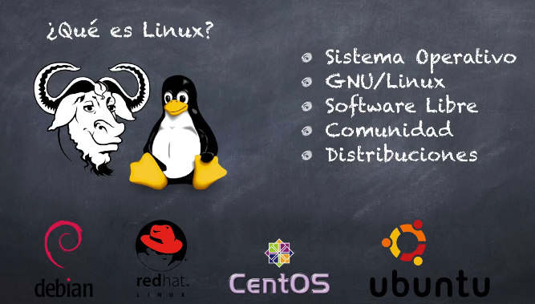
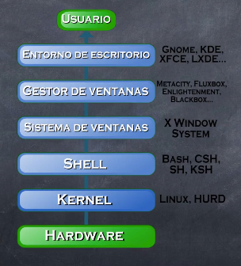

# Tema 2: Encontrando el camino en un sistema Linux:

## Introduccion a Linux

### 📍Que es Linux?



Linux es un sistema operativo de código abierto y gratuito basado en Unix, creado por Linus Torvalds en 1991. Técnicamente, la palabra «Linux» designa solo al kernel (el núcleo que conecta el hardware con el software), pero en el uso cotidiano se refiere al sistema operativo completo que resulta de combinar ese núcleo con herramientas y aplicaciones

### 📍Sistema modular



El sistema modular de Linux funciona por capas independientes que se apilan desde el equipo físico hasta la interfaz que ves en pantalla, permitiéndote cambiar o quitar piezas sin afectar al resto del sistema.


1. **Kernel (Núcleo)**

- **Qué es**: El corazón del sistema operativo (como el propio kernel Linux o HURD).
- **Función**: Gestiona directamente los recursos del hardware (memoria RAM, procesador, discos y dispositivos conectados) y decide qué programa puede usarlos en cada momento.

2. **Shell (Intérprete de comandos)**

- **Qué es**: Una interfaz de texto que recibe órdenes escritas (ejemplos: Bash, CSH, SH, KSH).
- **Función**: Traduce tus instrucciones de texto a un lenguaje que el kernel entiende para ejecutar tareas, automatizar procesos o administrar el sistema sin necesidad de gráficos.

3. **Sistema de ventanas**

- **Qué es**: El motor gráfico base (como el clásico X Window System o el más moderno Wayland).
- **Función**: Permite dibujar elementos básicos en la pantalla y gestionar las entradas del ratón y el teclado en un entorno visual.

4. **Gestor de ventanas**

- **Qué es**: El programa encargado de controlar la apariencia y el comportamiento de cada ventana (ejemplos: Metacity, Fluxbox, Enlightenment, Blackbox).
- **Función**: Define cómo se abren, mueven, redimensionan, minimizan o cierran las ventanas de las aplicaciones.

5. **Entorno de escritorio**
- **Qué es**: La experiencia visual completa con la que interactúa el usuario (ejemplos: GNOME, KDE, XFCE, LXDE).
- **Función**: Agrupa el gestor de ventanas con barras de tareas, menús, iconos, fondos de pantalla y aplicaciones básicas (como el explorador de archivos o la configuración).


### 📍¿Por qué es tan útil esta modularidad?

- Ahorro de recursos: En un servidor sin monitor, puedes eliminar las tres capas gráficas superiores y quedarte solo con el Kernel y la Shell.
- Personalización total: Si tu computadora es antigua, puedes cambiar un entorno pesado como KDE por uno muy ligero como XFCE o usar únicamente un gestor de ventanas como Fluxbox, manteniendo intacto el resto del sistema.

## Aspectos basicos de la linea de comandos

### 📍Empezando en Bash: el prompt, pwd y man

<code>pwd</code> -> **Obtener la ruta del directorio en el que estoy trabajando**

<code>ls</code> -> **Listado de rirectorios**

-  <code>ls -l</code> -> **Listado de directorios con informacion mas detallada**

<code>cd < DIRECTORIO ></code> -> **Cambiar de directirio de trabajo**

<code>man</code> -> **Ofrece informacion sobre el comando que se le da** 

### 📍Mostrar texto por pantalla

<code>echo</code> -> **Repite por pantalla el texto que le pasemos**

### 📍Comandos type, which y name

<code>type + "Nombre del comando"</code> -> **Nos va a decir si el comando es interno o externo**

<code>which</code> -> **Nos muestra la ruta absoluta del programa que le indiquemos**

<code>uname</code> -> **muestra informacion sobre el S.O**

### 📍Variables. Set y Unset

<code>set</code> -> **Configura opciones del shell y muestra variables o funciones**

<code>unset</code> -> **Elimina variables o funciones de la sesión actual**

### 📍Entorno, comando history y env

<code>env</code> ->  **Muestra o modifica temporalmente las variables de entorno para ejecutar un comando**

<code>history</code> -> **Muestra el registro de comandos ejecutados previamente en la terminal**

### 📍Obtener ayuda

<code>man + comando</code> -> **Obtener ayuda de un comando**

<code>info + comando</code> -> **Obtenemos informacion mas extensa que con man**

<code>locate</code> -> **Obtenemos informacion de donde este algun elemento del sistema**

<code>/usr/share/doc/</code> -> **Documentacion interna del sistema**

<code>comando + --help</code> ->  **Ayuda muy breve de un comando**

### 📍Navegar por directorios

<code>cd</code> -> **Cambiar de directorio**

### 📍Mostrar contenido de un directorio

<code>ls</code> -> **Lista el contenido de un directorio**

### 📍Crear y borrar archivos y directorios

<code>mkdir</code> -> **Crea un directorio**

<code>rm -r "Nombre directorio"</code> -> **Elimina un directorio**

<code>touch</code> -> **Crea un archivo vacío; si ya existe, actualiza su marca de tiempo de modificación (no cambia el contenido)**

<code>rm</code> -> **Archivos (por defecto, solo archivos normales)**

<code>p / -parents</code> -> **crea los directorios principales si no existen**

<code>mv</code> -> **mueve y renombra archivos**

### 📍Rutas relativas y absolutas

<table>
  <thead>
    <tr>
      <th></th>
      <th>Absoluta</th>
      <th>Relativa</th>
    </tr>
  </thead>
  <tbody>
    <tr>
      <th>Qué es</th>
      <td>Contiene <strong>todos los niveles</strong> desde la raíz <code>/</code></td>
      <td>Solo tiene sentido <strong>respecto a la ubicación actual</strong></td>
    </tr>
    <tr>
      <th>Empieza por</th>
      <td><strong><code>/</code></strong></td>
      <td>No (nombre o símbolo)</td>
    </tr>
    <tr>
      <th>Ventaja</th>
      <td>Funciona <strong>desde cualquier lugar</strong></td>
      <td><strong>Más corta</strong> y fácil de escribir</td>
    </tr>
    <tr>
      <th>Inconveniente</th>
      <td><strong>Tediosa</strong> de escribir</td>
      <td>Depende de dónde estés</td>
    </tr>
    <tr>
      <th>Ejemplo</th>
      <td><code>/home/user/Documents/Reports</code></td>
      <td><code>Reports</code> o <code>../Documents</code></td>
    </tr>
  </tbody>
</table>

### 📍Copiar ficheros y directorios

<code>mv</code> -> **Copia archivos y directorios**

- **Si el último argumento es un directorio** -> crea copias de los argumentos anteriores **dentro** de él.
- Se pueden copiar **varios archivos a la vez** (destino debe ser un directorio).
- Si **ambos operandos son archivos y ambos existen** → **sobrescribe** el segundo con una copia del primero.
- Por defecto `cp` **solo funciona con archivos individuales** -> error `omitting directory`.
- **`r`** (recursivo) → copia el directorio **y su contenido**:

 `cp -rv files directories`


### 📍 Globbing (coincidencia de patrones)

**Definición:** lenguaje sencillo de **coincidencia de patrones** que usan los shells para referirse a **grupos de archivos**.

### **Caracteres de coincidencia**

| **Carácter** | **Significado** |
| --- | --- |
| **`*`** | Coincide con **cualquier número de caracteres cualesquiera**, incluida la **ausencia** de caracteres |
| **`?`** | Coincide con **cualquier carácter único** |
| **`[]`** | Coincide con **una clase de caracteres** (conjunto, rango o clase) |

**Ejemplos con `*`:**

```
$ ls star*      → star10, star1100, star2002, star2013
$ ls star1*     → star10, star1100
$ ls star2*2    → star2002
```

> ⚠️ **El shell expande el patrón ANTES de ejecutar el comando**: `ls star*` no pasa `star*` a `ls`, sino la **lista de archivos coincidentes**.
> 

**Escape `\`:** anula el significado especial del shell:

```
$ ls star\*     → ls: cannot access star*: No such file or directory
```

(le pasa a `ls` el argumento **literal** `star*`).

**Ejemplos con `?`:**

```
$ ls question?    → question1
$ ls question1?   → question13, question14, question15
$ ls question?3   → question13, question23
```

**Ejemplos con `[]`:**

```
$ ls file[ab]     → filea, fileb
$ ls file[24]     → file2, file4
$ ls file[1-2]    → file1, file2
$ ls file[1-25-7] → file1, file2, file5, file6, file7   (varios rangos)
$ ls file[^a]     → todo excepto filea                  (negación con ^)
```

- **`!`** también niega (aunque Bash también acepta `^`).
- dentro de `[]` → **rango** (ej.: `[1-3]`).

### **Clases de caracteres POSIX: `[:<nombre>:]`**

```
$ ls file[[:digit:]]     → file1 … file7
$ ls file[[:digit:]a]    → file seguido de dígito o "a"
```

| **Clase** | **Significado** |
| --- | --- |
| **`[:alnum:]`** | Letras y números |
| **`[:alpha:]`** | Letras (mayúsc. o minúsc.) |
| **`[:blank:]`** | Espacios y tabulaciones |
| **`[:cntrl:]`** | Caracteres de control |
| **`[:digit:]`** | Números (0-9) |
| **`[:graph:]`** | Caracteres gráficos (todo excepto ctrl y espacio) |
| **`[:lower:]`** | Minúsculas (a-z) |
| **`[:print:]`** | Imprimibles (alnum, punct y espacio) |
| **`[:punct:]`** | Puntuación (`!`, `&`, `"`…) |
| **`[:space:]`** | Espacios en blanco (tabulaciones, espacios, saltos) |
| **`[:upper:]`** | Mayúsculas (A-Z) |
| **`[:xdigit:]`** | Dígitos hexadecimales |

### **Uso práctico del globbing**

Se combina con **`cp`, `mv`, `rm`** para operar con **varios archivos a la vez**:

bash

```
$ cp question* backup/     # copia todos los que empiezan por "question"

``` 